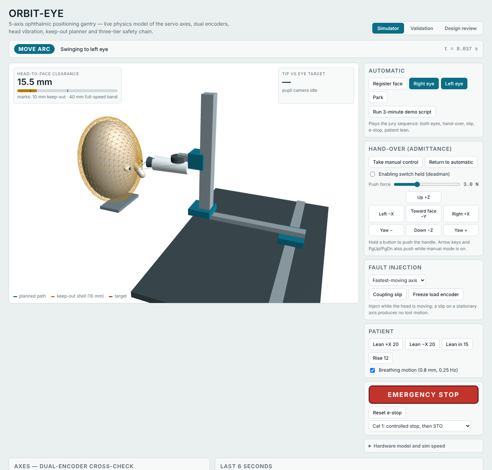
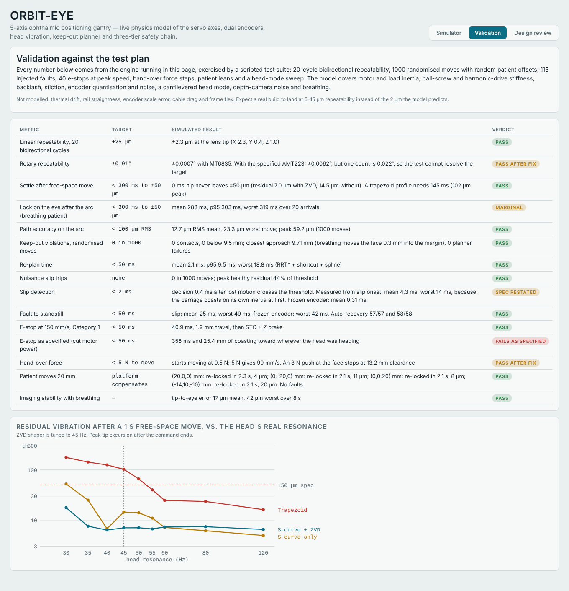

# ORBIT-EYE

A five-axis positioning gantry for ophthalmic imaging (X-Y-Z Cartesian stage plus a pan-tilt head) that moves an imaging head between the patient's eyes on its own, keeps out of a registered no-go zone around the face, catches drivetrain slip through dual encoders, and hands over to the operator's hand. This repository holds a physics simulation of the whole system, a validation suite that checks it against the project's test plan, and an interactive 3D simulator.



## What is in here

| Path | Contents |
|---|---|
| `sim/engine.js` | Simulation engine: kinematics, face keep-out geometry, RRT* planner, trajectory generation, drivetrain physics, servo loops, encoders, safety supervisor |
| `sim/validate.js` | Test suite: repeatability, settling, 1000 randomised moves, fault injection, e-stop, hand-over, patient motion, resonance sweep |
| `results/results.json` | Output of the last validation run |
| `web/index.html` | Self-contained 3D simulator (open it in a browser) |
| `web/template.html` | Page source; `build.js` inlines the engine and results into it |

## Run it

Requires Node.js 18 or later. No dependencies.

```bash
npm run validate   # ~3 minutes; rewrites results/results.json
npm run build      # rebuilds web/index.html with the new results
```

Open `web/index.html` in a browser. It loads Three.js r128 from cdnjs for the 3D view; the physics, controls and charts run without it. **Run 3-minute demo script** plays the jury sequence: right eye, left eye, operator hand-over, coupling slip, e-stop and recovery, patient lean.

## How the simulation works

- **Geometry.** The patient's head is an ellipsoid with a nose capsule. The imaging head is a chain of five spheres along its optical axis. Clearance is the surface-to-surface distance; the keep-out margin is 10 mm.
- **Planner.** Straight line if it clears; otherwise RRT* in the 5-D joint space with an edge cost that penalises time spent within 40 mm of the face, then shortcutting and a clamped cubic B-spline. Plans take 2 ms on average and under 20 ms worst case.
- **Trajectory.** Speed limit along the path from speed-and-separation monitoring (slower near the face), curvature and per-axis limits; forward/backward acceleration pass; a 25 ms box FIR for a jerk-limited S-curve; a ZVD input shaper at the head's 45 Hz mode.
- **Drivetrain.** Each axis is a two-mass model: reflected motor and screw inertia, drivetrain stiffness (15 N/µm ball screw, 800 N·m/rad harmonic drive), backlash, stiction on the load. A cantilevered head mode (default 45 Hz, ζ = 0.02) is driven by the tip's acceleration.
- **Control.** Velocity loop at 10 kHz on the motor encoder (α-β observer), position loop at 1 kHz on the load encoder with PI plus velocity, acceleration and friction feed-forward. Physics runs at 20 kHz.
- **Sensing.** AS5048A 14-bit on each motor; AS5311 magnetic scale on each linear carriage; MT6835 21-bit on each rotary output (AMT223 selectable for comparison). Depth camera at 30 Hz with 0.3 mm noise; on-head pupil camera at 100 Hz for the final 4 mm of alignment.
- **Safety.** Software: look-ahead keep-out check and replanning when the face moves. Firmware: 10 kHz motor-versus-load cross-check against the expected elastic deflection, keep-out breach trip at 6 mm, soft limits, controlled stop, retract along the clearance gradient, re-reference and resume. Hardware: Category 1 e-stop (controlled stop, then Safe Torque Off and Z brake), with Category 0 selectable for comparison.

## Validation results

| Metric | Target | Simulated |
|---|---|---|
| Linear repeatability (20 bidirectional cycles) | ±25 µm | ±2.3 µm |
| Rotary repeatability | ±0.01° | ±0.0007° (MT6835); AMT223 cannot resolve the target (0.022°/count) |
| Settle after free-space move | <300 ms to ±50 µm | 0 ms; residual 7 µm with ZVD, 102 µm with a trapezoid profile |
| Lock on the eye after the arc, breathing patient | <300 ms to ±50 µm | mean 283 ms, worst 319 ms (marginal) |
| Path accuracy | <100 µm RMS | 12.7 µm mean, 23 µm worst move |
| Keep-out violations | 0 in 1000 | 0 contacts, 0 below 9.5 mm |
| Re-plan time | <50 ms | mean 2.0 ms, worst 19 ms |
| Nuisance slip trips | none | 0 in 1000 moves |
| Slip detection | <2 ms | 0.4 ms after 10 µm lost motion; 3–14 ms from slip onset |
| Fault to standstill | <50 ms | worst 49 ms; 115/115 automatic recoveries |
| E-stop at 150 mm/s, Category 1 | <50 ms | 41 ms, 1.9 mm travel |
| E-stop cutting motor power (original spec) | <50 ms | 356 ms, 25 mm coasting |
| Hand-over force | <5 N | moves from 0.5 N; 90 mm/s at 5 N; virtual wall holds 13 mm from the face |
| Patient leans 20 mm | compensate | re-locked in 2.1–2.3 s, 4–20 µm error, no faults |
| Imaging stability with breathing | — | 17 µm mean, 42 µm worst |

The model leaves out thermal drift, rail straightness, encoder scale error, cable drag and frame flex. Expect a physical build at 5–15 µm repeatability.



## Design changes the simulation forced

1. **E-stop:** cutting motor power lets the head coast 25 mm. Use a Category 1 stop through a safety relay with delayed contacts, STO on the drives, a spring-applied brake on Z, and dynamic braking as backup.
2. **Rotary load encoder:** AMT223 (14-bit, 0.022°) cannot verify ±0.01°. Use MT6835 (21-bit) on each output.
3. **Linear load sensing:** an encoder on the screw end cannot see the nut. Put an AS5311 magnetic scale on each carriage.
4. **Ball screws:** SFU1605 backlash (≈20 µm) doubles the slip threshold. Use preloaded DFU1605.
5. **Loop rates:** a 1 kHz current loop is too slow. FOC drives run current at ≥16 kHz and velocity at 10 kHz; the Teensy 4.1 runs position at 1 kHz and the cross-check at 10 kHz.
6. **Hand-over:** lowering the current limit cannot make a 5 mm-lead axis yield to 5 N (≈100 kg reflected inertia). Use admittance control from a load-cell handle with an enabling switch.
7. **Torque from encoders:** a 15 N/µm screw deflects 0.3 µm under 5 N, below one count. Present the dual encoders as slip/jam detection; torque estimation works only on the harmonic-drive axes.
8. **Slip spec:** restate as "fault declared within 0.5 ms of 10 µm lost motion".
9. **Fine alignment:** the D405 is too noisy for ±50 µm. Use it for registration and keep-out; use an on-head pupil camera and corneal-reflex focus for the final 4 mm.
10. **Path verification:** log path error from load encoders through forward kinematics; spot-check with a dial indicator and a close-range ChArUco board.
11. **Planner cost:** shortest paths hug the face and get throttled. The clearance-weighted cost gives wide arcs in about 2 s.
12. **Head resonance:** expect 30–60 Hz, not >100 Hz. S-curve plus ZVD keeps residual vibration under 18 µm from 30 to 120 Hz.
13. **Patient motion:** if the face moves faster than 8 mm/s, retreat 20 mm and hold until still, then replan.
14. **Pan-tilt motors:** replace the D6374 with GM4108-class gimbal motors and 30:1 harmonic drives.

Net bill-of-materials change is about +₹35,000, for roughly ₹2.15 lakh in total. Prices are estimates.

## Team

ORBIT-EYE is developed by a student team from the Department of Biomedical Engineering.

| Role | Name |
|---|---|
| Team lead | Chellammai N (732923BMR014) |
| Mentor | K. P. Amalnath |

## License

MIT — see [LICENSE](LICENSE).
